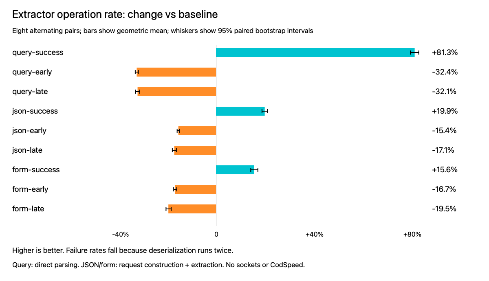

# Extractor error-path timing

Local comparison of always-tracked deserialization against retry-on-failure
in `Query`, `Json`, and `UrlEncodedForm`. No CodSpeed or sockets are used.

## Method

- Baseline: workspace HEAD `5d2189dbd79ac16d855b855429695511155aed4d`, before the three extractor edits.
- Candidate: the same workspace with only those production edits.
- Rust: `rustc 1.100.0-beta.7 (fd8e211ae 2026-10-17)`, macOS.
- Both binaries use `cargo build -p actix-web-lab --example extractor_timing --release --locked`.
- Cargo.lock SHA-256: `d70e785542f682e31e363d1c3cc5e36a7204e865582e9f87c019de91c6ebe8c1`.
- Baseline binary SHA-256: `6a798c1684adc7111fb14424374443139f8a757328a6a8a14f92b368e122e7ec`.
- Candidate binary SHA-256: `2568a0d9707db1c3bbf8c77edc2310b0795505d2e495e4b6517cec6fa76949c5`.
- Eight paired rounds alternate binary order. Each case has one second of warmup and one second of measurement. Clock checks occur once per 100 iterations.
- The timing run starts after compilation and lint checks finish.
- Existing unrelated `russe` workspace edits are present in both builds.

The payload is `{ n: u32, s: String, b: bool }`. Valid JSON is
`{"n":123,"s":"hi there","b":false}`; form/query input is
`n=123&s=hi+there&b=false`. Early failure replaces `n` with `bad`; late failure
replaces `b` with `bad`. These are first/last-field data errors in a small payload,
not near-limit payload failures.

Query timing calls `Query::from_query`. JSON and form timing includes
`TestRequest` construction, body buffering, and `FromRequest`. All cases check
success/failure, validate successful fields, and format errors on failure.
There is no router dispatch, handler, response body, or network. Absolute times
must not be compared across extractor types as equivalent request workloads.

`raw.csv` retains counts and elapsed nanoseconds. `summary.json` reports arithmetic
mean nanoseconds per operation, geometric mean paired speed change, and a seeded
10,000-resample paired bootstrap interval. Intervals describe this local session,
not independent machine runs. Compiler layout and machine noise remain possible.

## Repeat

Build the example on the baseline and copy the executable to
`/tmp/extractor-before`. Build it with the extractor edits and copy it to
`/tmp/extractor-after`. Keep the harness, compiler, features, and lockfile identical.
Do not run compilation or other heavy work during measurement.

```sh
node benchmarks/extractor-error-paths/run.mjs benchmarks/extractor-error-paths/raw.csv
node benchmarks/extractor-error-paths/analyze.mjs
```

The harness is `actix-web-lab/examples/extractor_timing.rs`. The captured binaries
precede formatting and variable-name cleanup in the harness; executable behavior
is unchanged. Production changes are limited to the three Serde extractors.

## Behavior

The retry retains detailed errors for deterministic deserializers. JSON keeps its
existing acceptance of trailing input. Body limits and content-type checks stay
before deserialization. Custom deserializers can run twice, repeat side effects,
return a different error, or succeed on retry. The public extractor docs state
this behavior, and a regression test covers a successful second attempt.

## Results

Positive speed change means more operations per second. Negative means fewer.

| Case | Before ns/op | After ns/op | Speed change | 95% paired interval |
| --- | ---: | ---: | ---: | ---: |
| query-success | 327.3 | 180.5 | 81.27% | 79.50% to 82.96% |
| query-early | 420.3 | 621.9 | -32.42% | -33.02% to -31.75% |
| query-late | 619.8 | 912.4 | -32.07% | -32.90% to -31.18% |
| json-success | 890.5 | 742.4 | 19.94% | 18.82% to 21.08% |
| json-early | 1056.8 | 1249.0 | -15.39% | -15.89% to -14.88% |
| json-late | 1179.4 | 1422.2 | -17.06% | -17.85% to -16.19% |
| form-success | 1061.2 | 918.2 | 15.57% | 14.23% to 17.14% |
| form-early | 1139.5 | 1367.8 | -16.69% | -17.30% to -16.04% |
| form-late | 1335.6 | 1658.4 | -19.46% | -20.43% to -18.33% |

Success improves in all three measured cases. Failure costs increase in all six
measured cases. The outcome supports this change for success-heavy workloads,
but does not establish a gain for error-heavy traffic or full HTTP requests.

## Validation

- `cargo test -p actix-web-lab --lib --test extractor_error_paths --locked --quiet`: 147 unit tests and 4 integration tests passed.
- `just clippy`: workspace, all targets, all features passed without warnings.
- Changed Rust files were formatted with nightly rustfmt using the workspace config.
- `change.patch` records the production edits and the added form diagnostic test.



To regenerate the PNG on macOS:

```sh
swift -module-cache-path /tmp/extractor-swift-cache benchmarks/extractor-error-paths/chart.swift benchmarks/extractor-error-paths
```

The benchmark baseline predates the current upstream main branch. These results
apply to the recorded source and dependency versions, not a refreshed upstream build.
